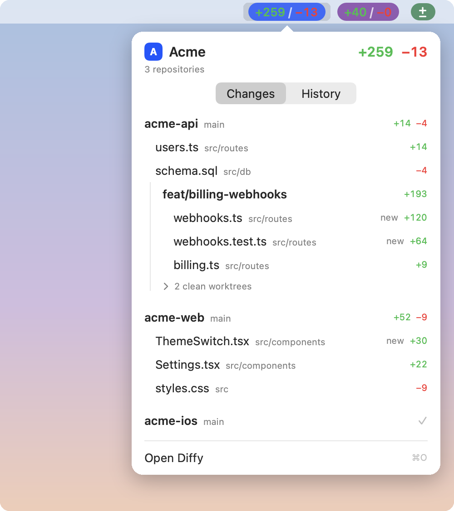

<p align="center">
  
</p>

# Diffy

A small native macOS menu bar app that shows live working-tree diff stats for your local git repositories. Local-only and read-only: no accounts, no cloud, no GitHub/GitLab.




## Features

- **Groups**: each group of repositories gets its own menu-bar badge with its combined `+added / −removed` lines, its own colour and an optional label. `±` means everything is clean.
- **Popover**: click a badge to see what changed. Clean repositories take one line; changed ones list their files with status (new, deleted, renamed, conflict) and counts. Click a file to open it in your editor.
- **Worktrees**: linked worktrees are discovered automatically and shown under their repository. Clean ones at the end of the list fold away. You can track a worktree separately, stop tracking it, or remove it.
- **History**: recent commits per repository, with unpushed commits marked and the upstream shown as a divider. Diffy never fetches.
- **Your order**: drag repositories and worktrees to reorder them, in the popover or the Diffy window.
- **Diffy window** (⌘O): manage groups, colours, labels, editors and repositories. Right-click a badge to add a repository, open Settings or hide the badge.

## Install

```bash
brew tap tiliakoos/diffy
brew install --cask diffy
xattr -dr com.apple.quarantine /Applications/Diffy.app
```

Requires macOS 26. Diffy is ad-hoc signed, not notarized, so the `xattr` step is needed after every install or upgrade (`brew upgrade --cask diffy`).

## Read-only

Diffy only runs observational git commands (`status`, `diff`, `log`, `show`, `rev-list`, `rev-parse`, `worktree list`) with optional locks off. The one exception is **Remove Worktree…**, which you confirm and which runs `git worktree remove` without `--force`.

## Build from source

```bash
swift test
./script/build_and_run.sh                     # builds, signs and launches dist/Diffy.app
./script/package_release.sh <version> <build> # release zip in dist/release/
```

## License

MIT © 2026 Nick Tiliakos. See [LICENSE](LICENSE).
